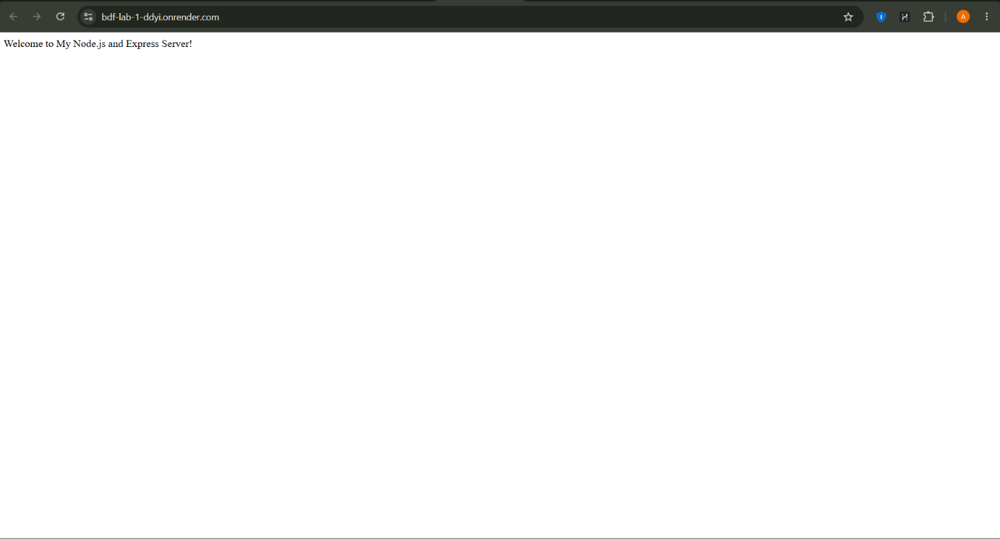
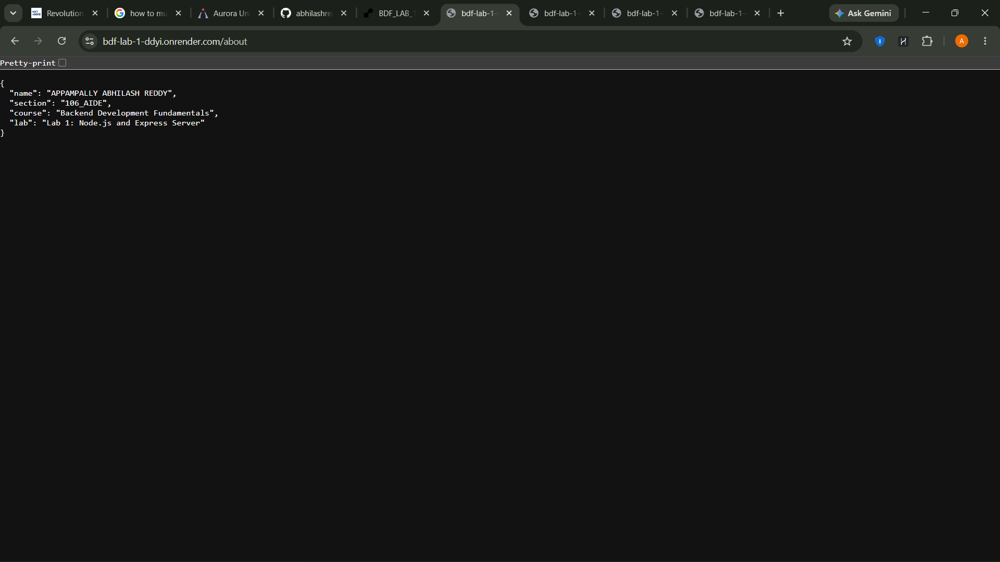
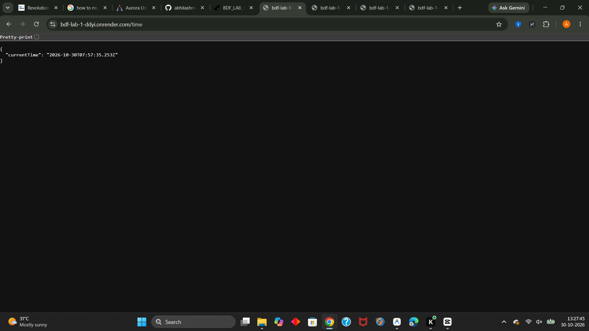

# AURORA UNIVERSITY
## SCHOOL OF COMPUTER SCIENCE & ENGINEERING
### DEPARTMENT OF COMPUTER SCIENCE AND ENGINEERING (AI & ML / DS / CSE)

---

# LABORATORY REPORT
### Course Code: CSE-BDF-201
### Course Title: Backend Development Fundamentals

---

## EXPERIMENT - 01
## Title: Node.js and Express Server Development & Deployment

---

### STUDENT CREDENTIALS
| Field | Details |
| :--- | :--- |
| **Student Name** | APPAMPALLY ABHILASH REDDY |
| **Registration Number** | 252U1R5008 |
| **Course** | B.Tech - Computer Science & Engineering |
| **Year / Semester** | II Year / IV Semester |
| **Section** | 106_AIDE |
| **Academic Year** | 2025 – 2026 |
| **Faculty Evaluator** | [ENTER FACULTY / INSTRUCTOR NAME] |
| **Date of Performance** | [ENTER DATE, e.g., 30-October-2026] |
| **Date of Submission** | [ENTER SUBMISSION DATE] |

---

## 1. AIM
To build, configure, test, and deploy a RESTful web server using Node.js and the Express.js framework, implement customized GET API endpoints, handle 404 HTTP errors, and publish the application publicly on Render with version control hosted on GitHub.

---

## 2. LEARNING OBJECTIVES
Upon completion of this practical experiment, students should be able to:
1. Initialize and configure a modern Node.js project using npm and understand the structure of `package.json`.
2. Understand the architecture of the Node.js event loop, asynchronous non-blocking I/O, and the V8 JavaScript engine.
3. Construct a low-level HTTP web server using the Node.js standard built-in `http` module.
4. Install and configure the Express.js application framework.
5. Create structured API endpoints returning both raw text and JSON (JavaScript Object Notation).
6. Implement middleware for capturing unmatched routes and returning custom 404 HTTP error messages.
7. Understand and utilize dynamic environment variables (`process.env.PORT`) and IP binding (`0.0.0.0`).
8. Deploy the web server to a cloud-based Platform-as-a-Service (PaaS) such as Render.
9. Maintain standard source code version control practices using Git and GitHub.

---

## 3. SOFTWARE AND TOOLS REQUIRED
- **Operating System:** Windows 10 / 11
- **Runtime Environment:** Node.js (v24.x / LTS installed)
- **Package Manager:** Node Package Manager (npm v11.x)
- **Framework:** Express.js (v4.21.x)
- **Source Code Editor:** Visual Studio Code
- **Version Control:** Git & GitHub
- **API Testing Tools:** Google Chrome / Microsoft Edge Browser, cURL, PowerShell WebRequest
- **Cloud Hosting Platform:** Render (Free Tier Web Service)

---

## 4. THEORETICAL FOUNDATION

### 4.1 Node.js Overview
Node.js is an open-source, cross-platform JavaScript runtime environment built on Google Chrome's V8 JavaScript engine. It executes JavaScript outside the web browser. Node.js operates on an event-driven, single-threaded, non-blocking I/O model, making it exceptionally lightweight, efficient, and well-suited for data-intensive real-time applications running across distributed devices.

### 4.2 Built-in `http` Module
Node.js includes a native module named `http` that provides functionality to transfer data over the Hypertext Transfer Protocol. Using `http.createServer()`, developers can listen on a specified port and handle incoming requests manually by parsing URLs, setting headers using `res.writeHead()`, and terminating streams with `res.end()`.

### 4.3 Express.js Web Framework
Express.js is a minimal, unopinionated, and flexible Node.js web application framework that provides a robust set of features for web and mobile applications. It abstracts boilerplate code from the low-level `http` module, offering:
- Elegant URL routing mechanisms (`app.get()`, `app.post()`, etc.).
- Convenient response formatters (`res.send()`, `res.json()`).
- Modular middleware pipeline for handling authentication, logging, and error handling.

### 4.4 HTTP Status Codes
HTTP response status codes indicate whether a specific HTTP request has been successfully completed:
- **`200 OK`**: Standard response for successful HTTP requests.
- **`404 Not Found`**: Indicates that the server cannot find the requested resource.

---

## 5. STEP-BY-STEP PROCEDURE

### Step 1: Project Directory and Node.js Initialization
1. Open Visual Studio Code terminal in the project directory `BDF_LAB_1/lab-01`.
2. Initialize a new Node.js project manifest:
   ```bash
   npm init -y
   ```
3. Update `package.json` with descriptive scripts for execution (`start`, `dev`, `http`).

### Step 2: Express.js Installation
1. Install Express as a production dependency:
   ```bash
   npm install express
   ```
2. Verify that `node_modules` and `package-lock.json` are created, and `express` is listed under `dependencies` in `package.json`.

### Step 3: Implement Native HTTP Server (`http-server.js`)
1. Create `http-server.js`.
2. Import `http` via `require('http')`.
3. Invoke `http.createServer((req, res) => { ... })` and return the response string `"Hello"`.
4. Listen on TCP port `3000`.

### Step 4: Implement Express.js Application Server (`server.js`)
1. Create `server.js`.
2. Initialize Express instance using `const app = express()`.
3. Configure `PORT = process.env.PORT || 3000`.
4. Implement Route 1: `GET /` returning `"Welcome to My Node.js and Express Server!"`.
5. Implement Route 2: `GET /about` returning JSON object containing student credentials.
6. Implement Route 3: `GET /time` returning JSON containing the current date and time via `new Date()`.
7. Implement Route 4: Fallback middleware `app.use(...)` returning HTTP 404 JSON for unmatched routes.
8. Bind listener using `app.listen(PORT, '0.0.0.0')`.

### Step 5: Verification & Quality Assurance
1. Run automated test suite verifying all 4 endpoints and their corresponding HTTP status codes.
2. Confirm 100% test pass rate locally.

### Step 6: Git Version Control and GitHub Repository Creation
1. Create a `.gitignore` file preventing `node_modules/` from being tracked.
2. Initialize Git, commit all project files, and push to GitHub.

### Step 7: Cloud Deployment on Render
1. Connect the GitHub repository to Render as a Web Service.
2. Configure Root Directory to `lab-01`, Build Command to `npm install`, and Start Command to `node server.js`.
3. Obtain public production URL and test endpoints.

---

## 6. SOURCE CODE LISTINGS

### 6.1 `package.json`
```json
{
  "name": "lab-01",
  "version": "1.0.0",
  "description": "Backend Development Fundamentals Lab 1 - Node.js and Express Server",
  "main": "server.js",
  "scripts": {
    "start": "node server.js",
    "dev": "node --watch server.js",
    "http": "node http-server.js"
  },
  "keywords": [
    "nodejs",
    "express",
    "aurora-university",
    "backend-development"
  ],
  "author": "APPAMPALLY ABHILASH REDDY",
  "license": "ISC",
  "dependencies": {
    "express": "^4.21.2"
  }
}
```

### 6.2 `http-server.js` (Built-in HTTP Module)
```javascript
const http = require('http');

const PORT = 3000;

// Create HTTP server instance
const server = http.createServer((req, res) => {
  // Set response HTTP status code to 200 (OK) and content-type header
  res.writeHead(200, { 'Content-Type': 'text/plain; charset=utf-8' });
  
  // Send response body
  res.end('Hello');
});

// Start listening on port 3000
server.listen(PORT, () => {
  console.log(`Node.js HTTP Server is running on http://localhost:${PORT}`);
});
```

### 6.3 `server.js` (Express Server Implementation)
```javascript
const express = require('express');

// Initialize the Express application
const app = express();

// Configure the port from environment variables or default to 3000
const PORT = process.env.PORT || 3000;

// Built-in middleware to parse incoming JSON payloads
app.use(express.json());

// Route: GET /
app.get('/', (req, res) => {
  res.status(200).send('Welcome to My Node.js and Express Server!');
});

// Route: GET /about
app.get('/about', (req, res) => {
  res.status(200).json({
    name: 'APPAMPALLY ABHILASH REDDY',
    section: '106_AIDE',
    course: 'Backend Development Fundamentals',
    lab: 'Lab 1: Node.js and Express Server'
  });
});

// Route: GET /time
app.get('/time', (req, res) => {
  const currentTime = new Date();
  res.status(200).json({
    currentTime: currentTime
  });
});

// 404 Not Found Middleware (Registered after all valid routes)
app.use((req, res) => {
  res.status(404).json({
    success: false,
    message: '404 - Route Not Found'
  });
});

// Server Initialization
app.listen(PORT, '0.0.0.0', () => {
  console.log(`Express Server is running on port ${PORT}`);
  console.log(`Local Access: http://localhost:${PORT}`);
});
```

---

## 7. EXECUTION RESULTS AND VERIFICATION

### Automated Test Output
```text
Express Server is running on port 3000
Local Access: http://localhost:3000

=== RUNNING EXPRESS SERVER ENDPOINT TESTS ===

TEST 1: GET /
Status Code: 200 ✅ PASS
Response Body: Welcome to My Node.js and Express Server!
--------------------------------------------------
TEST 2: GET /about
Status Code: 200 ✅ PASS
Response Body: {"name":"APPAMPALLY ABHILASH REDDY","section":"106_AIDE","course":"Backend Development Fundamentals","lab":"Lab 1: Node.js and Express Server"}
--------------------------------------------------
TEST 3: GET /time
Status Code: 200 ✅ PASS
Response Body: {"currentTime":"2026-10-30T05:28:06.765Z"}
--------------------------------------------------
TEST 4: GET /invalid (404 Not Found Handling)
Status Code: 404 ✅ PASS
Response Body: {"success":false,"message":"404 - Route Not Found"}
--------------------------------------------------

🎉 ALL 4 ENDPOINT TESTS PASSED COMPLETELY!
```

---

## 8. API ENDPOINT TESTING TABLE

| Test Case # | Request URL | HTTP Method | Expected Status | Actual Status | Content-Type | Status Verdict |
| :---: | :--- | :---: | :---: | :---: | :--- | :---: |
| **TC-01** | `http://localhost:3000/` | GET | `200 OK` | `200 OK` | `text/html; charset=utf-8` | **PASSED** |
| **TC-02** | `http://localhost:3000/about` | GET | `200 OK` | `200 OK` | `application/json; charset=utf-8` | **PASSED** |
| **TC-03** | `http://localhost:3000/time` | GET | `200 OK` | `200 OK` | `application/json; charset=utf-8` | **PASSED** |
| **TC-04** | `http://localhost:3000/invalid` | GET | `404 Not Found` | `404 Not Found` | `application/json; charset=utf-8` | **PASSED** |
| **TC-05** | `http://localhost:3000/` (HTTP Server) | GET | `200 OK` | `200 OK` | `text/plain; charset=utf-8` | **PASSED** |

---

## 9. SCREENSHOTS RECORD

> *Note for Student: Save your actual browser and terminal screenshots in `lab-01/screenshots/`.*

### Figure 1: Root Endpoint (`GET /`)


### Figure 2: About Endpoint (`GET /about`)


### Figure 3: Time Endpoint (`GET /time`)


### Figure 4: 404 Error Handling (`GET /invalid`)


### Figure 5: Servers Running in Terminal


---

## 10. COMPREHENSIVE VIVA VOCE QUESTIONS & ANSWERS

### Q1: What is Node.js?
**Answer:** Node.js is an open-source, cross-platform JavaScript runtime environment that executes JavaScript code outside a web browser. Built on Google Chrome's V8 engine, Node.js features an event-driven, single-threaded, non-blocking asynchronous architecture that allows developers to write scalable backend services using JavaScript.

### Q2: What is Express.js?
**Answer:** Express.js is a lightweight, fast, and minimalist web framework built on top of Node.js. It simplifies building web servers and RESTful APIs by providing high-level routing, request and response utilities, and a flexible middleware architecture.

### Q3: What is `package.json`?
**Answer:** `package.json` is the manifest file for a Node.js project. It records essential project metadata (name, version, description, author), specifies third-party dependencies (`dependencies` and `devDependencies`), and defines custom terminal execution scripts (`npm start`, `npm run dev`).

### Q4: What is `node_modules`?
**Answer:** `node_modules` is a directory created automatically by npm when packages are installed. It physically stores the downloaded source code of all direct and transitive third-party dependencies required by the application. Because of its large size, it should never be committed to Git.

### Q5: What is the difference between Node.js and Express.js?
**Answer:**
- **Node.js** is a runtime environment that allows JavaScript to execute on a computer/server.
- **Express.js** is a software framework that runs inside Node.js to streamline building web servers, routing, and HTTP request handling without writing complex boilerplate code.

### Q6: What does `http.createServer()` do?
**Answer:** `http.createServer()` is a method provided by Node.js's built-in `http` module. It creates and returns a new HTTP server instance that triggers a callback function containing the `req` (IncomingMessage) and `res` (ServerResponse) streams every time an HTTP request hits the server.

### Q7: What does `app.listen()` do?
**Answer:** In Express.js, `app.listen()` binds the web application to a specified TCP port (and optionally an IP host like `0.0.0.0`) and starts listening for incoming client network connections. It is a convenience wrapper around Node's native `http.createServer(app).listen()`.

### Q8: What are the `req` (Request) and `res` (Response) objects?
**Answer:**
- **`req` (Request):** An object representing the incoming HTTP request from the client. It contains parameters, headers, URL path, query strings, and body payload.
- **`res` (Response):** An object representing the outgoing HTTP response generated by the server. It contains methods to set HTTP status codes (`res.status()`), set headers (`res.set()`), and send data back to the client (`res.send()`, `res.json()`).

### Q9: What is an API endpoint?
**Answer:** An API endpoint is a specific digital location or URL where an API receives requests for a resource on a server. It is typically defined by a uniform resource identifier (URI) paired with an HTTP verb (such as `GET`, `POST`, `PUT`, `DELETE`).

### Q10: What is an HTTP status code?
**Answer:** An HTTP status code is a standardized 3-digit integer issued by a server in response to a client's request made to the server. The first digit defines the class of response:
- `1xx`: Informational
- `2xx`: Success (e.g., `200 OK`)
- `3xx`: Redirection
- `4xx`: Client Error (e.g., `404 Not Found`)
- `5xx`: Server Error (e.g., `500 Internal Server Error`)

### Q11: What is the difference between HTTP 200 and HTTP 404?
**Answer:**
- **`200 OK`**: Indicates that the client's request was successfully received, understood, and processed by the server, and the requested payload is being returned.
- **`404 Not Found`**: Indicates that the server could not locate any resource or route matching the requested URL path.

### Q12: Why do we use `process.env.PORT`?
**Answer:** Cloud platforms and hosting providers (such as Render, AWS, Heroku) dynamically assign a port number to your running application at container startup. Using `process.env.PORT || 3000` enables the application to dynamically bind to the port provided by the host environment while seamlessly falling back to port `3000` during local development.

### Q13: What is middleware in Express.js?
**Answer:** Middleware functions are functions that have access to the request object (`req`), the response object (`res`), and the `next` middleware function in the application’s request-response cycle. They can execute code, modify `req` and `res`, end the request-response cycle, or call `next()` to pass control down the pipeline.

### Q14: Why do we use `.gitignore`?
**Answer:** `.gitignore` is a text file that specifies intentionally untracked files and directories that Git should ignore. It prevents committing bloated folders (like `node_modules/`), environment secrets (`.env`), system files (`.DS_Store`), or temporary build logs to remote repositories.

---

## 11. CONCLUSION
The experiment on Node.js and Express Server was executed successfully. Through this lab:
1. Both low-level Node.js HTTP server and high-level Express server architectures were constructed and evaluated.
2. RESTful GET endpoints (`/`, `/about`, `/time`) were implemented returning appropriate content formats and `200 OK` status codes.
3. Centralized 404 error handling middleware was integrated to handle invalid routes.
4. Source code was organized according to production standards, version controlled via Git, and prepared for public cloud deployment on Render.

---

## 12. PROJECT SUBMISSION LINKS
- **GitHub Repository URL:** [https://github.com/abhilashreddy-sketch/BDF_LAB_1](https://github.com/abhilashreddy-sketch/BDF_LAB_1)
- **Render Public Deployment URL:** [https://bdf-lab-1-ddyi.onrender.com](https://bdf-lab-1-ddyi.onrender.com)
- **Lab 1 Folder Path:** `BDF_LAB_1/lab-01`
