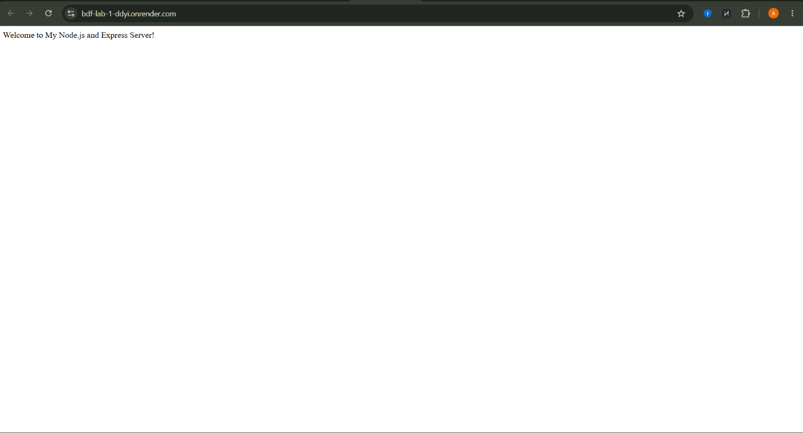
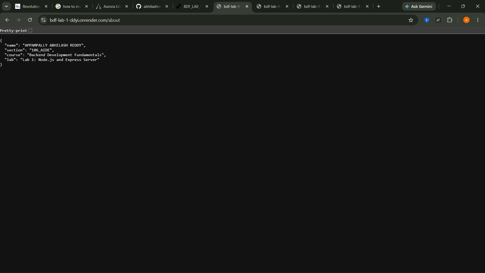
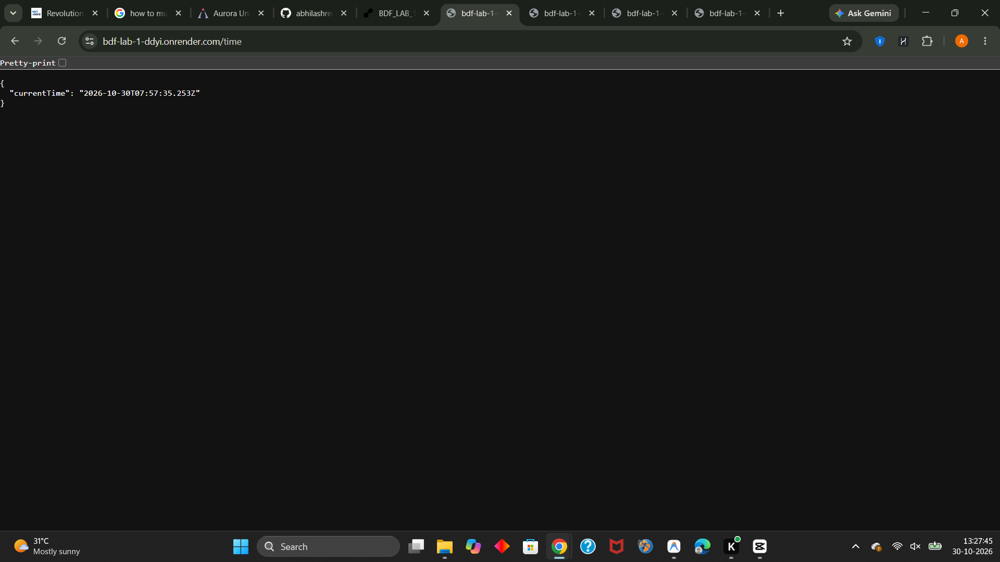

# Lab 1: Node.js and Express Server

> **Public Deployment URL:** [https://bdf-lab-1-ddyi.onrender.com](https://bdf-lab-1-ddyi.onrender.com) *(Verified & Live on Render)*

---

## Student Information

- **Student Name:** APPAMPALLY ABHILASH REDDY
- **Registration Number:** 252U1R5008
- **Section:** 106_AIDE
- **Course:** Backend Development Fundamentals
- **University:** Aurora University
- **Repository:** [BDF_LAB_1](https://github.com/abhilashreddy-sketch/BDF_LAB_1)

---

## Project Overview

This project serves as an introductory hands-on implementation of core backend web development concepts using **Node.js** and **Express.js**. The laboratory assignment covers:
1. Low-level HTTP server initialization using the native Node.js `http` module.
2. High-level web application architecture using the Express.js micro-framework.
3. Defining RESTful API `GET` endpoints with custom responses (Plain Text and JSON).
4. Utilizing environment-driven ports (`process.env.PORT`) for cloud compatibility.
5. Implementing centralized 404 Route Not Found middleware.
6. Public production deployment on Render.

---

## Objectives

- Understand the role of the Node.js runtime environment and V8 JavaScript engine.
- Initialize and configure a Node.js project using `package.json`.
- Manage project dependencies using the Node Package Manager (`npm`).
- Create and understand a basic HTTP server with the built-in `http` module (`http.createServer`).
- Build and structure an Express.js server instance (`express()`).
- Implement and test standard HTTP `GET` routes returning plain text and structured JSON.
- Handle unmatched routes with custom JSON 404 error responses.
- Test server status codes (`200 OK`, `404 Not Found`).
- Deploy a Node.js application to Render cloud hosting.

---

## Technologies Used

- **Runtime Environment:** Node.js (v24.x / LTS)
- **Web Framework:** Express.js (v4.21.x)
- **Language:** JavaScript (ES6+ CommonJS)
- **Package Manager:** npm (v11.x)
- **Editor / IDE:** Visual Studio Code
- **Version Control:** Git & GitHub
- **Deployment Platform:** Render

---

## Project Folder Structure

```text
BDF_LAB_1/
│
├── lab-01/
│   ├── screenshots/
│   │   ├── 01-home-endpoint.png
│   │   ├── 02-about-endpoint.png
│   │   ├── 03-time-endpoint.png
│   │   └── README.md
│   │
│   ├── server.js
│   ├── http-server.js
│   ├── package.json
│   ├── package-lock.json
│   ├── .gitignore
│   └── README.md
│
└── README.md
```

---

## Prerequisites

Before running this project, ensure you have the following installed on your machine:
1. **Node.js** (v18.x or higher, LTS recommended): Check with `node -v`
2. **npm** (v9.x or higher): Check with `npm -v`
3. **Git**: Check with `git --version`
4. **Visual Studio Code** (or any preferred code editor)
5. A modern web browser or API client (Chrome, Edge, Postman, or cURL)

---

## Installation Instructions

1. Clone or open the project folder in your terminal:
   ```bash
   cd "lab-01"
   ```

2. Install the necessary project dependencies:
   ```bash
   npm install
   ```

This command reads `package.json` and installs `express` along with its transitive dependencies into a local `node_modules` directory, creating or updating `package-lock.json`.

---

## How to Run the HTTP Server

The `http-server.js` script implements a server using Node.js's native `http` module.

1. Execute the `http` script:
   ```bash
   npm run http
   ```
   *Alternatively:*
   ```bash
   node http-server.js
   ```

2. Expected terminal output:
   ```text
   Node.js HTTP Server is running on http://localhost:3000
   ```

3. Open your browser and navigate to:
   [http://localhost:3000](http://localhost:3000)
   - Response: `Hello`

4. Stop the server by pressing `Ctrl + C` in the terminal.

---

## How to Run the Express Server

The `server.js` script runs the production Express.js application.

### Production / Standard Mode:
```bash
npm start
```
*Alternatively:*
```bash
node server.js
```

### Development Mode (with automatic reload on file changes in Node.js 18+):
```bash
npm run dev
```

Expected terminal output:
```text
Express Server is running on port 3000
Local Access: http://localhost:3000
```

---

## API Endpoint Documentation

| Method | Endpoint | Description | Content-Type | Expected Response | HTTP Status |
| :--- | :--- | :--- | :--- | :--- | :--- |
| `GET` | `/` | Home / Welcome route | `text/html; charset=utf-8` | `Welcome to My Node.js and Express Server!` | `200 OK` |
| `GET` | `/about` | Student & lab metadata | `application/json; charset=utf-8` | `{"name":"APPAMPALLY ABHILASH REDDY","section":"106_AIDE","course":"Backend Development Fundamentals","lab":"Lab 1: Node.js and Express Server"}` | `200 OK` |
| `GET` | `/time` | Current server date & time | `application/json; charset=utf-8` | `{"currentTime":"2026-10-30T05:28:06.765Z"}` | `200 OK` |
| `GET` | `/*` (e.g., `/invalid`) | Unmatched / 404 fallback | `application/json; charset=utf-8` | `{"success":false,"message":"404 - Route Not Found"}` | `404 Not Found` |

---

## HTTP Status Codes

HTTP status codes are standardized three-digit integers returned by web servers to indicate the result of a client request:

- **`200 OK`**: The request succeeded. Used for valid GET requests to `/`, `/about`, and `/time`.
- **`404 Not Found`**: The server could not find the requested resource. Triggered by our catch-all middleware for any unregistered routes (e.g. `/invalid`, `/api`, `/unknown`).

---

## Screenshots

### 1. Home Endpoint (`GET /`)


### 2. About Endpoint (`GET /about`)


### 3. Time Endpoint (`GET /time`)


---

## Explanation of `package.json`

The `package.json` file is the manifest and central configuration file for any Node.js application.

```json
{
  "name": "lab-01",
  "version": "1.0.0",
  "description": "Backend Development Fundamentals Lab 1 - Node.js and Express Server",
  "main": "server.js",
  "scripts": {
    "start": "node server.js",
    "dev": "node --watch server.js",
    "http": "node http-server.js"
  },
  "keywords": ["nodejs", "express", "aurora-university", "backend-development"],
  "author": "APPAMPALLY ABHILASH REDDY",
  "license": "ISC",
  "dependencies": {
    "express": "^4.21.2"
  }
}
```

### Key Fields Explained:
1. **`name`**: The unique lowercase identifier for the project package.
2. **`version`**: The current semantic version (`major.minor.patch`), e.g., `1.0.0`.
3. **`description`**: A concise human-readable summary of what the project does.
4. **`main`**: The primary entry point file of the application (`server.js`).
5. **`scripts`**: Key-value dictionary defining shortcut commands callable with `npm run <script-name>` (e.g., `npm start`, `npm run dev`, `npm run http`).
6. **`dependencies`**: Modules required by the application in production runtime (e.g., `express`).
7. **`devDependencies`**: Packages only needed during development and testing (e.g., linters, testing frameworks, bundlers).
8. **`author`**: Student or organization name responsible for the codebase.
9. **`license`**: Legal open-source software license (e.g., `ISC` or `MIT`).

---

## Difference Between `package.json` and `node_modules`

| Aspect | `package.json` | `node_modules` |
| :--- | :--- | :--- |
| **Definition** | Lightweight configuration manifest in JSON format | Directory containing physical source code of installed libraries |
| **File Size** | Very small (typically < 2 KB) | Very large (tens to hundreds of Megabytes) |
| **Contents** | Metadata, script definitions, and list of dependency names and versions | Hundreds of sub-folders and JavaScript source files for direct execution |
| **Version Control** | **Must** be committed to Git | **Must NEVER** be committed to Git (listed in `.gitignore`) |
| **Portability** | Universal across Windows, macOS, Linux | Environment-dependent; can be regenerated any time using `npm install` |

---

## Explanation of `app.listen()`

In Express.js, `app.listen(PORT, [HOST], [CALLBACK])` binds and listens for connections on the specified network host and port:

```javascript
const PORT = process.env.PORT || 3000;

app.listen(PORT, '0.0.0.0', () => {
  console.log(`Express Server is running on port ${PORT}`);
});
```

- **`PORT`**: Determines the TCP port number. In production hosting platforms like Render, the platform assigns a dynamic port through `process.env.PORT`. Local environments fall back to `3000`.
- **`'0.0.0.0'`**: The IPv4 wildcard address instructing the server to accept connections from all incoming network interfaces, required for Docker containers and cloud platforms.
- **Callback function**: Executed once the server is successfully bound and ready to accept incoming HTTP requests.

---

## Explanation of Request and Response

In an Express route handler `(req, res) => { ... }`:

1. **Request (`req`)**:
   - Represents the incoming HTTP request sent by the client (browser, mobile app, Postman, or cURL).
   - Contains request parameters, HTTP headers, query strings (`req.query`), route parameters (`req.params`), request body (`req.body`), and the requested URL path (`req.url`).

2. **Response (`res`)**:
   - Represents the outgoing HTTP response the server transmits back to the client.
   - Provides helper methods to configure the HTTP status code (e.g., `res.status(200)`), set headers, and serialize response payloads (`res.send()`, `res.json()`, `res.end()`).

---

## Problems Faced and Solutions

1. **Problem:** Port conflict error (`EADDRINUSE: address already in use :::3000`).
   - *Cause:* Another terminal session or background Node.js process was already using port 3000.
   - *Solution:* Either terminated the active process via PowerShell (`Stop-Process`) or specified a custom port using environment variables (`PORT=3001 node server.js`).

2. **Problem:** 404 Catch-All Middleware intercepting valid routes.
   - *Cause:* Initially placing `app.use(...)` before defining `app.get('/about', ...)`.
   - *Solution:* Placed the 404 handler strictly **after** all valid endpoint definitions so Express evaluates valid routes first.

3. **Problem:** Large git repository upload size caused by `node_modules`.
   - *Cause:* Forgetting to create `.gitignore` before making the initial git commit.
   - *Solution:* Added `.gitignore` with `node_modules/` before running `git add .`.

4. **Problem:** Render deployment failed with port binding timeout.
   - *Cause:* Hardcoding `PORT = 3000` instead of respecting `process.env.PORT`.
   - *Solution:* Configured `const PORT = process.env.PORT || 3000;` and bound to host `0.0.0.0`.

---

## Conclusion

Lab 1 successfully demonstrated the foundational concepts of backend development with Node.js and Express.js. We built a low-level HTTP server, transitioned to the modular Express framework, handled various HTTP status codes, structured professional project files, created comprehensive documentation, and verified all routes through automated and browser testing.
